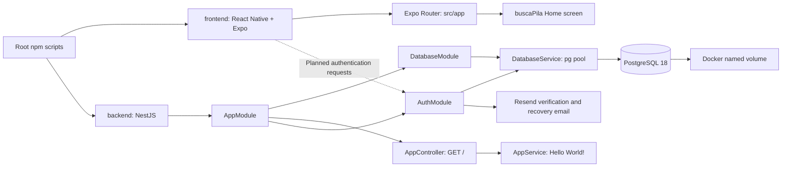
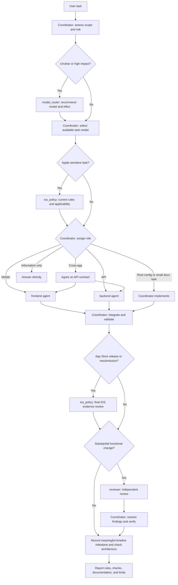

# Architecture

## Current state

buscaPila has two independent TypeScript applications in one Git repository.
The mobile app contains a minimal buscaPila Home screen; Expo tutorial screens and demo navigation have been removed. The API exposes GET / returning Hello World!.
PostgreSQL 18 is configured locally with Docker Compose and connected to NestJS through a node-postgres pool. Startup performs SELECT 1, and db:check verifies a real connection. The backend provides first-party email and password authentication, authenticator verification, and mobile Bearer sessions. The mobile client integration and production deployment are pending.

## System diagram

Solid arrows describe implemented relationships. Dashed arrows describe planned connections.

This shows logical ownership and calls, not a deployment topology. The existing API uses port 3000 by default.
A physical phone must use the PC's reachable network address rather than localhost. PostgreSQL is bound only to 127.0.0.1 (port 5433 on this workstation). The phone never receives database credentials or connects to PostgreSQL directly. The auth migration adds the database records needed for credentials, challenges, rate limits, and sessions. The [authentication API contract](api/auth.md) describes the mobile routes.
The mobile app targets iOS and Android; an Android JavaScript export has passed, but this is not native/device verification.

## Agent workflow

The coordinator automatically routes implementation tasks without requiring the user to name agents.
The coordinator assigns non-overlapping files and waits for review before closing substantial functional work.
Timeline maintenance and architecture checks are part of task completion. Diagrams change only when relationships or workflows change.
The model routing policy is documented in MODEL_ROUTING.md. Role and model selection are independent; the main chat model is unchanged. Model recommendations must be applied through supported spawn overrides and availability must be checked. ios_policy advises before Apple-sensitive changes and checks available evidence before App Store submissions; it is not a runtime component or approval guarantee. This workflow operates during active Codex tasks; it is not a background watcher or an npm command hook.

## Change rules

- Update the diagram when real modules or connections change; use actual implementation names.
- Convert a dashed connection to solid only after implementation and a successful real request.
- Add data stores or external services only when configured and implemented, and label unverified behavior.
- Record meaningful milestones in TIMELINE.md using BACKEND, FRONTEND, or SHARED.
- Keep runtime architecture separate from the agent collaboration workflow.
