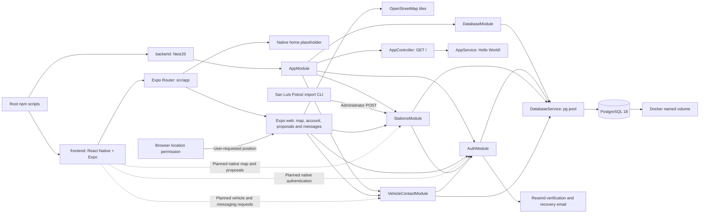
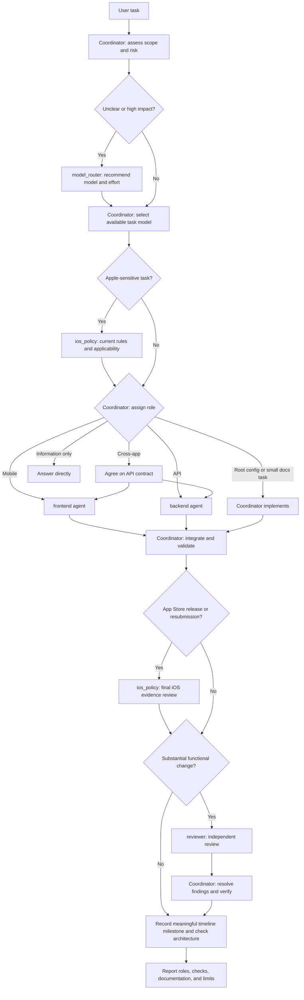

# Architecture

## Current state

buscaPila has two independent TypeScript applications in one Git repository.
Expo web provides a Leaflet charging map, station details, community reports and proposals, account access, vehicle registration, and private charging conversations. The station drawer shows either map results or the selected station's charger details while the map stays mounted. On narrow screens, charger details fill the visible viewport and returning restores the station list. The native target currently displays the buscaPila placeholder. The API exposes GET / returning Hello World!.
PostgreSQL 18 is configured locally with Docker Compose and connected to NestJS through a node-postgres pool. Startup performs SELECT 1, and db:check verifies a real connection. The backend provides first-party authentication, community charging status, station proposal review, vehicle registration, authenticated exact-match vehicle lookup, and private charging messages. The mobile client integration and production deployment are pending.

Timed occupancy reports store their duration and report time in PostgreSQL. Station reads derive availability from the latest report and the database clock. Expo web displays the countdown and refreshes station results at the next expiration while retaining the map view.

At lower zoom levels, the web map groups nearby stations and labels each group with its charger total. At high zoom, the same viewport request can include charger details so the map can place individual chargers with known coordinates. The station pin represents chargers with no mapped position, and overlapping points share a marker that opens the corresponding station results.

## System diagram

Solid arrows describe implemented relationships. Dashed arrows describe planned connections.

This shows logical ownership and calls. The existing API uses port 3000 by default. Local browser requests use an explicit loopback CORS origin, and access and refresh tokens live in browser memory for the life of the page. On request, the browser position centers the map and sorts stations by distance. API and tile requests use the viewed area.
A physical phone must use the PC's reachable network address rather than localhost. PostgreSQL is bound only to 127.0.0.1 (port 5433 on this workstation). The phone never receives database credentials or connects to PostgreSQL directly. Versioned migrations create the authentication, charging catalog, and vehicle contact schema. See the API contracts for [authentication](api/auth.md), [charging and station proposals](api/charging.md), and [vehicles and messages](api/vehicle-contact.md).

The web contact screen looks up a vehicle by VIN or Mexican plate through the authenticated API. For a unique plate registration, the API issues an expiring opaque token that binds the subsequent message to the requesting account and the same registration. The vehicle contact module uses the auth module's existing token encryption service for this binding.

The web registration form sends a Mexican plate and VIN. The API records the issuing region as unknown. Mexican plate registration, plate-only lookup, and token-based delivery for the same plate share a transaction lock.
The mobile app targets iOS and Android; an Android JavaScript export has passed, but this is not native/device verification.

The [station catalog import CLI](STATION_CATALOG_IMPORT.md) submits validated source listings through the administrator station route. PostgreSQL stores external listing identities in `station_sources` and links them to charging stations so retries can resolve to the original station.

## Agent workflow

The coordinator automatically routes implementation tasks without requiring the user to name agents.
The coordinator assigns non-overlapping files and waits for review before closing substantial functional work.
Timeline maintenance and architecture checks are part of task completion. Diagrams change only when relationships or workflows change.
The model routing policy is documented in MODEL_ROUTING.md. Role and model selection are independent; the main chat model is unchanged. Model recommendations must be applied through supported spawn overrides and availability must be checked. ios_policy advises before Apple-sensitive changes and checks available evidence before App Store submissions; it is not a runtime component or approval guarantee. This workflow operates during active Codex tasks; it is not a background watcher or an npm command hook.

## Change rules

- Update the diagram when real modules or connections change; use actual implementation names.
- Convert a dashed connection to solid only after implementation and a successful real request.
- Add data stores or external services only when configured and implemented, and label unverified behavior.
- Record meaningful milestones in TIMELINE.md using BACKEND, FRONTEND, or SHARED.
- Keep runtime architecture separate from the agent collaboration workflow.
