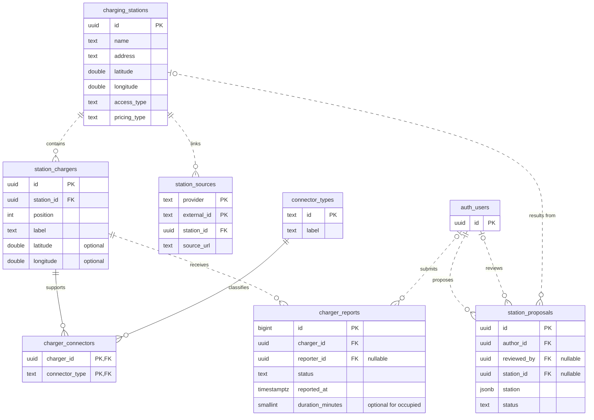
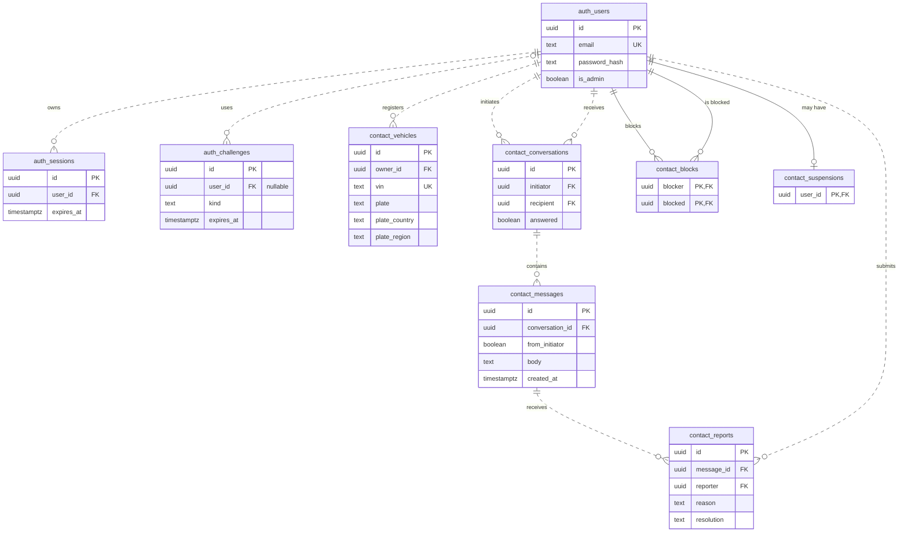

# PostgreSQL database design

The diagrams show the schema defined by the [versioned migrations](../backend/migrations/). They include the fields needed to understand relationships and recent features. The migrations define the complete columns, constraints, and indexes.

## Stations and charging

`charger_availability` is a view over chargers and their latest reports. A timed occupied report becomes available in the view once its deadline passes. The original report remains in `charger_reports`. Station availability totals are computed from the view.

## Accounts, vehicles, and messages

Vehicle plate uniqueness uses the combination of `plate_country`, `plate_region`, and `plate`. A vehicle helps resolve the recipient at the start of contact. Conversations link the two accounts directly.

`auth_rate_limits` tracks request budgets by bucket. The migration runner records applied migrations in `buscapila_migrations`. These tables have no foreign keys to the product tables.
