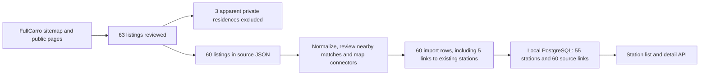
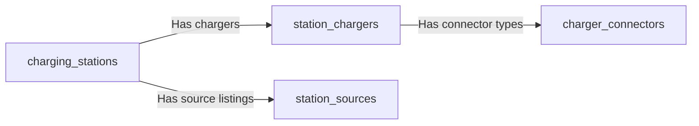
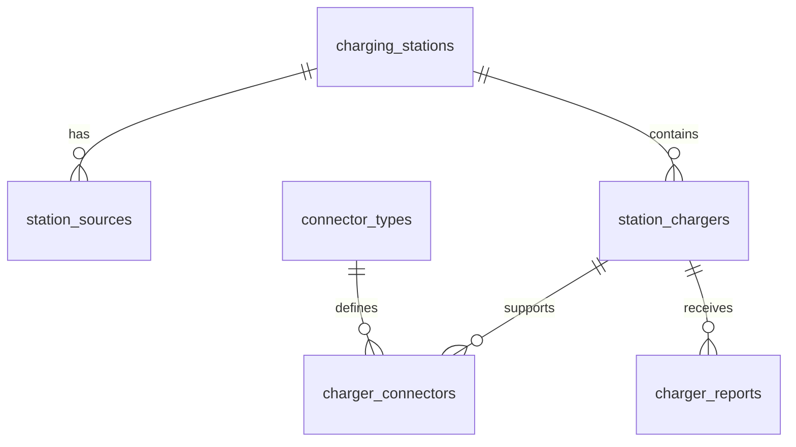

# Station catalog import

## FullCarro pilot in San Luis Potosí

The pilot collected station details from public FullCarro pages on November 24, 2026. The operator used the sitemap to locate the listings and read the public page and Schema.org metadata in a user-attended Chrome session. The state catalog contained 63 listings. Three apparent private residences were excluded from the import, leaving 60 source listings linked to 55 stations in local PostgreSQL.



| File | Contents |
| --- | --- |
| [Source JSON](../data/san-luis-potosi-fullcarro.json) | Published station names, addresses, coordinates, listing URLs, connector types, outlet counts, and available network or hours metadata |
| [Review JSON](../data/san-luis-potosi-fullcarro-full-review.json) | Review notes for all 63 listings, including the exclusions and unresolved equipment details |
| [Import batch](../data/san-luis-potosi-fullcarro-batch.json) | Station input, normalized connector codes, FullCarro source keys, and local station IDs for the five linked listings |

The [cleanup script](../scripts/clean-station-catalog.mjs) identifies repeated source URLs and nearby records for review. Five listings in this pilot were linked to other stations after comparing address and proximity. Their source records were retained. FullCarro keys use `fullcarro` as the provider and the locality/listing path as the external ID.

## Database schema

Migration `005_station_sources.sql` adds a `station_sources` table to link external catalog listings to charging stations. One station can have several source listings, including listings from different providers. The relationship lets repeat imports resolve a listing to the same station.



| Column        | Type | Constraint                                             |
| ------------- | ---- | ------------------------------------------------------ |
| `station_id`  | UUID | Required foreign key to `charging_stations.id`         |
| `provider`    | Text | Required stable provider code                          |
| `external_id` | Text | Required stable listing identifier within the provider |
| `source_url`  | Text | Required URL of the original listing                   |

Use `(provider, external_id)` as the composite primary key and index `station_id` for reverse lookups. Use the provider's listing ID when available. Use a canonical listing URL as the identifier only when it is stable and identifies a single listing. Keep stations created by the community valid without source rows.

## Field mapping

| Source data                                                 | Destination          |
| ----------------------------------------------------------- | -------------------- |
| Station name, address, latitude, and longitude              | `charging_stations`  |
| Identified equipment and optional equipment coordinates     | `station_chargers`   |
| Confirmed connector types per identified piece of equipment | `charger_connectors` |
| Provider, listing identifier, and original URL              | `station_sources`    |
| Access and charging cost categories                         | `charging_stations.access_type` and `charging_stations.pricing_type` |



Migration [008](../backend/migrations/008_station_classification.sql) adds the two classification fields with an `unknown` default. Access values are `public`, `private`, `restricted`, and `unknown`. Pricing values are `free`, `paid`, `mixed`, and `unknown`. The station list and detail responses include both fields.

## Access and charging cost

The verified local snapshot included 55 FullCarro-linked stations and 92 charger rows. The classification updated 31 stations with at least one known or estimated category. Access and pricing are stored independently. A public station can charge a fee, and a private station can offer free charging to authorized users.

| Field | Category | Meaning | Stations |
| --- | --- | --- | ---: |
| `access_type` | `public` | Open to the general public | 14 |
| `access_type` | `restricted` | Access is estimated to depend on conditions such as being a guest or making an appointment | 13 |
| `access_type` | `private` | Access is estimated to be limited to authorized users, such as staff at a private facility | 2 |
| `access_type` | `unknown` | Access rules are unknown | 26 |
| `pricing_type` | `free` | The listing reports free charging | 3 |
| `pricing_type` | `paid` | The listing reports a charging fee | 1 |
| `pricing_type` | `mixed` | The station offers both free and paid charging | 0 |
| `pricing_type` | `unknown` | Charging cost is unknown | 51 |

Plaza San Luis was classified as `public` and `free`. Solarium Energy was classified as `restricted` and `paid`. The BMW Group plant was classified as `private` with pricing set to `unknown`. Access classifications are venue-based estimates. Pricing categories reflect the listings reviewed and do not capture parking fees or exact rates. The source JSON retains published outlet counts and other listing metadata.

Example station fields as stored in PostgreSQL and returned by the API after classification.

```json
[
  { "name": "PLAZA SAN LUIS", "access_type": "public", "pricing_type": "free" },
  { "name": "SOLARIUM ENERGY", "access_type": "restricted", "pricing_type": "paid" },
  { "name": "BMW GROUP PLANTA SAN LUIS POTOSÍ", "access_type": "private", "pricing_type": "unknown" }
]
```

Use the existing connector catalog to map provider labels to buscaPila codes. When identified equipment has no label, generate a label such as `Charger 1`. The current model stores connector types per charger. Connector counts and power in kW are outside this proposal.

## Import behavior

1. Run the local cleanup script and validate the result before writing to PostgreSQL.
2. Resolve known listings using the provider and external ID. For a new listing, attach it to an existing station only after confirming the location match. Send ambiguous matches to review.
3. Create a station, its validated chargers, and its source links in one transaction. If the source key already belongs to a different station, roll back and flag the conflict for review. Reimporting the same listing must resolve to the existing station and preserve its charger IDs and community reports.
4. When a provider publishes only site-wide connector types, create one charger per published connector type and do not infer counts from the number of plugs. Community reports refine the equipment later. The backend requires at least one charger with a cataloged connector type. Migration 006 adds `household_outlet` and `nema_14_50` for household-outlet listings.
5. When listings for the same physical site are merged, the primary station must carry the union of their connector types. A request with `existingStationId` only links the source and ignores its chargers.

## Acceptance checks

- Importing the same listing twice keeps one station and one source link.
- Two confirmed listings for the same physical site can link to one station.
- Conflicting source links and incomplete charger records are reported for review.
- Existing community stations and charger reports remain accessible after the migration.

## San Luis Potosí pilot

Prepare a JSON batch with `region` set to `MX-SLP` and a `stations` array. Each station uses the existing station input fields with an added `source` object containing `provider`, `externalId`, and `sourceUrl`. To link a confirmed match to a station already in buscaPila, include its UUID as `existingStationId`. Select entries actually located in San Luis Potosí before preparing the batch.

This synthetic example shows the batch with station classifications and a proposed exact rate. When `pricing_type` is `paid`, include `price` if the rate is known. Omit `price` when the rate is unknown. The example means 8 MXN per kilowatt-hour. Before running the POST command, omit `access_type`, `pricing_type`, and `price` from the submitted file. Access and pricing categories can be applied in PostgreSQL after import. Exact rates would require a schema and API change.

```json
{
  "region": "MX-SLP",
  "stations": [
    {
      "name": "Example Charging Site",
      "address": "Example Address",
      "latitude": 22.13,
      "longitude": -101.04,
      "access_type": "public",
      "pricing_type": "paid",
      "price": {
        "amount": 8,
        "currency": "MXN",
        "unit": "kWh"
      },
      "chargers": [{ "label": "Charger 1", "connectorTypes": ["j1772"] }],
      "source": {
        "provider": "example",
        "externalId": "station-1",
        "sourceUrl": "https://example.com/stations/1"
      }
    }
  ]
}
```

```powershell
node scripts/post-san-luis-potosi-stations.mjs san-luis-potosi.json
```

The default run checks the input locally. Before submitting a batch, build the backend and run `npm.cmd run db:migrate` from `backend/` against the intended database. Set `STATION_API_URL` to the backend origin and `STATION_ADMIN_TOKEN` to an administrator access token in the environment, then rerun with `--apply`. The command sends one `POST /api/v1/stations` per row. It stops at the first failure and the batch can be replayed after resolving the error.

### Fullcarro pilot status

`data/san-luis-potosi-fullcarro-batch.json` holds 60 Fullcarro listings as 55 stations. Five listings within 30 m of another listing or at the same address are linked through `existingStationId`. The local development database received this batch on 2026-11-24 through a one-time direct SQL transaction rather than the API. Each row passed the backend `stationCreateInput` validator, and the transaction mirrored the station publish and source-link logic. Its station UUIDs are specific to that database, so another database must regenerate the batch instead of reusing these IDs.
